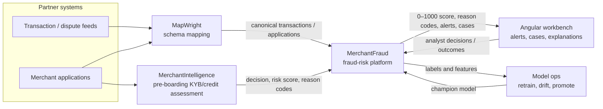

# MerchantFraud

Hybrid fraud-risk platform for merchant acquiring: explainable rules + ML scoring for application fraud, transaction abuse, chargebacks, and merchant network rings. .NET 10, Angular, SQLite.

## Goals

- Detect merchant application fraud, synthetic identities, bust-out behavior, transaction abuse, chargeback spikes, refund abuse, and linked merchant rings.
- Produce explainable 0–1000 fraud risk scores with reason codes.
- Keep deterministic rules first; ML models are optional scoring inputs, not black-box decision makers.
- Never store raw PAN or CVV. Mask PII and sensitive financial data by default.

## High-level workflow

1. **Ingest** partner transaction/application feeds through `MerchantFraud.Ingestion` or MapWright-mapped payloads. Ingestion validates rows, returns row-level errors, and masks IP/card data by default.
2. **Canonicalize** records into the shared fraud domain model: merchants, owners, applications, transactions, disputes, cases, scores, and audit events.
3. **Enrich** merchant activity with point-in-time features, deterministic rules, network links, ML signals, and MerchantIntelligence assessment signals.
4. **Score** merchants into capped 0–1000 `FraudRiskScore` results with reason codes and score signals.
5. **Persist and operate** through SQLite, the minimal API, alerts, cases, and the Angular workbench.
6. **Learn** from analyst decisions and dispute outcomes, then retrain, check drift, and promote champion/challenger models.

## Ecosystem flow



MapWright is the schema-translation layer: it maps partner-specific transaction/application fields into canonical MerchantFraud ingestion records. MerchantIntelligence is the upstream onboarding/KYB assessment: MerchantFraud consumes its decision, risk score, and reason codes as additional fraud signals instead of duplicating pre-boarding checks. MerchantFraud owns post-boarding fraud risk: transaction abuse, chargebacks, refunds, deterioration, network rings, alerts, cases, and model governance.

## Current status

Working foundation. The solution currently contains:

- `src/MerchantFraud.Core` — canonical fraud domain model and fraud risk score primitive.
- `src/MerchantFraud.Ingestion` — JSON/CSV transaction feed parsing with row-level errors and PII/PCI masking.
- `src/MerchantFraud.Features` — merchant-level feature extraction for activity, amount, refund, dispute, channel, and time-window behavior.
- `src/MerchantFraud.Rules` — deterministic fraud rules with review/decline actions and reason codes.
- `src/MerchantFraud.Scoring` — explainable 0–1000 fraud risk scoring from rule hits and feature signals.
- `src/MerchantFraud.Persistence` — SQLite store for merchants, transactions, disputes, score results, cases, and audit events.
- `src/MerchantFraud.Api` — ASP.NET Core minimal API for health, ingest, scoring, alerts, and cases.
- `src/MerchantFraud.Synthetic` — deterministic synthetic merchants, transactions, disputes, and fraud labels.
- `src/MerchantFraud.Ml` — supervised dataset builder, feature mapper, train/test split, metrics, logistic-regression baseline, model registry, and drift checks.
- `src/MerchantFraud.Network` — shared-identifier merchant link detection and network risk scoring.
- `src/MerchantFraud.Integrations` — external assessment and schema adapters for MerchantIntelligence and MapWright.
- `web/workbench` — Angular dashboard, alerts queue, merchant detail, and score explanation UI.
- `tests/MerchantFraud.Tests` — xUnit tests.
- `docs/wiki` — architecture, domain model, ingestion, features, rules, scoring, persistence, API, synthetic data, ML, network, integrations, workbench, model ops, operator guide, roadmap, and planning docs.

Planned projects include case management and production model serving.

## Build and test

```bash
dotnet build MerchantFraud.slnx
dotnet test MerchantFraud.slnx
```

## Examples

Ingest the sample transaction feed and score a merchant:

```bash
dotnet run --project src/MerchantFraud.Api --urls http://localhost:5292
curl -X POST http://localhost:5292/api/ingest/transactions -H "Content-Type: application/json" --data-binary @samples/transaction-feed.sample.json
curl -X POST http://localhost:5292/api/score/merchant -H "Content-Type: application/json" -d '{"merchantId":"MER-SAMPLE-001"}'
curl http://localhost:5292/api/alerts
```

Run the Angular workbench with `cd web/workbench && npm ci && npm start`.

## Deploy to Render

`Dockerfile` and `render.yaml` deploy the API and workbench as one Render web service. API routes are under `/api`; the workbench is served from the same service at `/`. The free plan uses ephemeral SQLite at `/var/data`; use a paid plan with a disk for persistent data.

## Documentation

- [Wiki home](docs/wiki/Home.md)
- [Architecture](docs/wiki/Architecture.md)
- [Roadmap](docs/wiki/Roadmap.md)
- [Operator guide](docs/wiki/Operator-Guide.md)

## Principles

1. Missing evidence is never treated as clear.
2. Every score carries reason codes and evidence.
3. Rules and workflows are versioned data where practical.
4. Analyst decisions and dispute outcomes feed back as labels.
5. Free/public/synthetic data first; paid providers are optional integrations.
