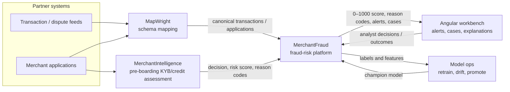

# MerchantFraud

Hybrid fraud-risk platform for merchant acquiring: explainable rules + ML scoring for application fraud, transaction abuse, chargebacks, and merchant network rings. .NET 10, Angular, SQLite.

## Goals

- Detect merchant application fraud, synthetic identities, bust-out behavior, transaction abuse, chargeback spikes, refund abuse, and linked merchant rings.
- Produce explainable 0–1000 fraud risk scores with reason codes.
- Keep deterministic rules first; ML models are optional scoring inputs, not black-box decision makers.
- Never store raw PAN or CVV. Mask PII and sensitive financial data by default.

## High-level workflow

1. **Ingest** partner transaction/application feeds through `MerchantFraud.Ingestion` or MapWright-mapped payloads. Ingestion validates rows, returns row-level errors, and masks IP/card data by default.
2. **Canonicalize** records into the shared fraud domain model: merchants, owners, applications, transactions, disputes, cases, scores, and audit events.
3. **Enrich** merchant activity with point-in-time features, deterministic rules, network links, ML signals, and MerchantIntelligence assessment signals.
4. **Score** merchants into capped 0–1000 `FraudRiskScore` results with reason codes and score signals.
5. **Persist and operate** through SQLite, the minimal API, alerts, cases, and the Angular workbench.
6. **Learn** from analyst decisions and dispute outcomes, then retrain, check drift, and promote champion/challenger models.

## Ecosystem flow



MapWright is the schema-translation layer: it maps partner-specific transaction/application fields into canonical MerchantFraud ingestion records. MerchantIntelligence is the upstream onboarding/KYB assessment: MerchantFraud consumes its decision, risk score, and reason codes as additional fraud signals instead of duplicating pre-boarding checks. MerchantFraud owns post-boarding fraud risk: transaction abuse, chargebacks, refunds, deterioration, network rings, alerts, cases, and model governance.

## How FraudShield decides — step by step

This section follows one merchant through the platform. For each component it lists what goes in, what decides the result, and how that result affects the final 0–1000 fraud risk score. All numbers below come straight from the code.

### The pipeline at a glance

| # | Component | Input | Output | Adds score points? |
| --- | --- | --- | --- | --- |
| 1 | Partner mapping (`MerchantFraud.Integrations` · MapWright) | Partner-format rows | Canonical transaction fields | No |
| 2 | Ingestion & masking (`MerchantFraud.Ingestion`) | JSON/CSV transaction feed | Validated, masked `FraudTransaction` records + row errors | No |
| 3 | Features (`MerchantFraud.Features`) | One merchant's transactions + disputes, as-of time | `MerchantFeatureSet` (rates, shares, velocity, tickets) | Yes — feature signals (step 5) |
| 4 | Rules (`MerchantFraud.Rules`) | Feature set | Rule hits, severity, recommended action | Yes — per hit |
| 5 | Scoring (`MerchantFraud.Scoring`) | Feature set, rule hits, optional extra signals | Score 0–1000, band, reason codes | Combines everything |
| 6 | Network (`MerchantFraud.Network`) | Many merchants' transactions | Shared-identifier links, network score | Yes, when supplied as an extra signal |
| 7 | MerchantIntelligence (`MerchantFraud.Integrations`) | Onboarding/KYB assessment | Score signals | Yes, when supplied as an extra signal |
| 8 | ML (`MerchantFraud.Ml`) | Labelled synthetic merchants | Trained model, metrics, fraud probability, drift | Yes, when supplied as an extra signal |
| 9 | Persistence, alerts & cases (`MerchantFraud.Persistence`, `MerchantFraud.Api`) | Score results | Stored scores, Alerts queue, cases, audit trail | No (acts on the score) |

`POST /api/score/merchant` uses steps 3–5 only (rules + feature signals, model version `rules-v1`). The Preset Lab (`MerchantFraud.Presets`) runs every step and feeds network, MerchantIntelligence and ML into scoring as extra signals.

### 1. Partner mapping (MapWright)

- **In:** a partner row such as `{ "txn_ref": "...", "amt": "25.00", "entry_mode": "online" }` and a `MapWrightTransactionProfile`, which maps canonical field → partner field (`amount` ← `amt`).
- **Decides:** field names match case-insensitively. Blank values are dropped and values are trimmed. Profile constants (for example a fixed `currency`) are applied first, then field mappings.
- **Out:** a dictionary using canonical names (`id`, `merchantId`, `occurredAt`, `amount`, `currency`, `channel`, `status`, `cardNumber`, `cardBin`, `cardLast4`, `customerId`, `deviceId`, `ipAddress`, ...).
- **Score impact:** none. It only lets any acquirer or gateway format reach ingestion.

### 2. Ingestion, validation and PII/PCI masking

- **In:** a JSON array (`{ "transactions": [...] }`) or CSV.
- **Required per row:** `id`, `merchantId`, `occurredAt` (ISO date), `amount` (decimal), `currency`. If one is missing or invalid, that row goes to `errors` as `Row N: ...`. The rest of the feed is still accepted.
- **Normalised values:**
  - `channel`: `cp` → CardPresent; `cnp`/`online`/`internet` → CardNotPresent; `ecommerce`/`ecom`/`web` → Ecommerce; `moto` → Moto; anything missing → Unknown.
  - `status`: `captured`, `settled`, `authorized` (the default), `declined`, `refunded`, `chargeback`/`cb` → ChargedBack.
- **Masking (always on by default):**
  - IPv4 addresses keep only the first two octets (`185.220.14.9` → `185.220.0.0`). Anything else becomes `***`.
  - A full card number (12+ digits) is reduced to its last 4. The full PAN is never stored.
- **Score impact:** none directly. Bad data is rejected here so it can't distort features.

### 3. Merchant features

- **In:** all transactions and disputes for one merchant, plus an `asOf` time. Activity after `asOf` is ignored, so features are point-in-time. Everything must be in one currency.
- **Calculated values:**

| Feature | Formula |
| --- | --- |
| `TransactionCount` | all transactions up to `asOf` |
| `DeclineRate` | declined ÷ all transactions |
| `RefundRate` | refunded ÷ all transactions |
| `DisputeRate` | disputes ÷ all transactions |
| `DisputeToVolumeRatio` | dispute amount ÷ processed volume (declines excluded) |
| `RefundToVolumeRatio` | refund amount ÷ processed volume |
| `CardNotPresentShare` / `EcommerceShare` / `MotoShare` / `CardPresentShare` | channel count ÷ all transactions |
| `RoundAmountShare` | round tickets (≥ 100 and a multiple of 100) ÷ non-declined transactions |
| `AverageTicket`, `MaxTicket`, `MaxTicketToAverageRatio` | over non-declined transactions |
| `TransactionsLast24Hours / 7Days / 30Days`, `VolumeLast…` | rolling windows ending at `asOf` |

- **Score impact:** features feed both the rules (step 4) and feature signals (step 5).

### 4. Deterministic rules

- **In:** the feature set.
- **Decides:** each rule in `FraudRuleCatalog.Default` is a fixed threshold. The minimum-count guards stop small merchants from being flagged on 2–3 transactions.

| Rule (reason code) | Fires when | Severity | Action | Score points |
| --- | --- | --- | --- | --- |
| `DISPUTE_RATE_HIGH` | dispute rate ≥ 3% | High | Review | 120 |
| `DISPUTE_RATE_CRITICAL` | dispute rate ≥ 10% | Critical | Decline | 250 |
| `DISPUTE_VOLUME_HIGH` | dispute volume ≥ 5% of processed volume | High | Review | 120 |
| `REFUND_RATE_HIGH` | refund rate ≥ 10% | Medium | Review | 60 |
| `REFUND_RATE_CRITICAL` | refund rate ≥ 30% | Critical | Decline | 250 |
| `DECLINE_RATE_HIGH` | ≥ 20 txns and decline rate ≥ 50% (card testing) | Medium | Review | 60 |
| `CNP_DOMINANT` | ≥ 20 txns and card-not-present share ≥ 90% | Medium | Review | 60 |
| `VELOCITY_24H_HIGH` | ≥ 100 transactions in last 24h | High | Review | 120 |
| `ROUND_AMOUNT_CONCENTRATION` | ≥ 20 txns and round-amount share ≥ 80% | Medium | Review | 60 |
| `TICKET_OUTLIER` | ≥ 10 txns and max ticket ≥ 10× average | Medium | Review | 60 |

- **Out:** the list of hits. The **recommended action** is the strongest action among the hits (None < Review < Decline). The **highest severity** is the strongest severity among the hits.
- **Score impact:** each hit adds points by severity: Critical 250, High 120, Medium 60, Low 25. Rules can stack: a 12% dispute rate hits both `DISPUTE_RATE_HIGH` and `DISPUTE_RATE_CRITICAL`.

### 5. Scoring (0–1000)

- **In:** feature set, rule evaluation, and optional extra signals (MerchantIntelligence, network, ML).
- **How the score is built:**
  1. Rule hits → points as above.
  2. Feature signals → softer, graduated points, so a merchant just below a rule threshold still gets some score:

     | Signal | Fires when | Points |
     | --- | --- | --- |
     | `FEATURE_DISPUTE_RATE` | dispute rate ≥ 1% | rate × 500, max 60 |
     | `FEATURE_REFUND_RATE` | refund rate ≥ 5% | rate × 400, max 50 |
     | `FEATURE_DECLINE_RATE` | decline rate ≥ 30% | rate × 100, max 40 |
     | `FEATURE_DISPUTE_VOLUME` | dispute volume ≥ 2% | ratio × 500, max 40 |
     | `FEATURE_CNP_DOMINANT` | CNP share ≥ 80% | 20 |
     | `FEATURE_ROUND_AMOUNTS` | round share ≥ 70% | 20 |
     | `FEATURE_TICKET_OUTLIER` | max ÷ avg ≥ 5 | ratio × 3, max 30 |
     | `FEATURE_VELOCITY_24H` | ≥ 50 / 100 / 200 txns in 24h | 20 / 30 / 40 |

  3. Extra signals → added as-is. Only positive points count.
  4. **Raw score** = sum of all points. **Final score** = min(raw, 1000).
- **Band:** Low < 250 ≤ Medium < 500 ≤ High < 750 ≤ Critical.
- **Reason codes:** the distinct codes of every signal. These explain the score in the UI.

### 6. Network analysis (merchant rings)

- **In:** transactions across many merchants.
- **Decides:** two merchants are **linked** when they share any of these identifiers:
  - a device ID
  - a masked IP
  - a customer ID
  - a card fingerprint (`brand:BIN:last4`)

  Each shared value between a pair is one link. `SharedTransactionCount` is the smaller of the two merchants' transaction counts for that value.
- **Network score per merchant:** each link adds weight × 10 + 2 × shared transactions. Weights are device 5, customer 4, card 3, IP 2. Then add 25 per distinct linked merchant, and cap at 1000.
- **Reason codes:** `NETWORK_SHARED_DEVICE`, `NETWORK_SHARED_CUSTOMER`, `NETWORK_SHARED_CARD`, `NETWORK_SHARED_IP`, plus `NETWORK_RING_SIZE` once a merchant links to 3 or more others.
- **Score impact (Preset Lab):** adds `NETWORK_LINKED_MERCHANTS` worth network score ÷ 5, capped at 200 points.

### 7. MerchantIntelligence onboarding signals

- **In:** the merchant's pre-boarding KYB/credit assessment: decision, risk score (0–1000) and reason codes.
- **Mapped signals:**

| Condition | Signal | Points |
| --- | --- | --- |
| Decision = Decline | `MI_DECISION_DECLINE` | 250 |
| Decision = Refer | `MI_DECISION_REFER` | 120 |
| MI risk ≥ 750 | `MI_RISK_HIGH` | 150 |
| MI risk ≥ 500 | `MI_RISK_MEDIUM` | 80 |
| MI risk ≥ 250 | `MI_RISK_LOW` | 30 |
| Any reason codes | `MI_REASON_CODES` | 10 per code, max 30 |

- **Score impact:** added as extra signals. A merchant that onboarding already doubted starts with a higher fraud score.

### 8. ML scoring and model operations

- **Training data:** `SyntheticDataGenerator` builds labelled merchants that rotate through four profiles: TransactionFraud (CNP, round tickets, refunds), ChargebackAbuse (disputes and chargebacks), ApplicationFraud, and None (legitimate). `FraudDatasetBuilder` runs the same feature extractor on them.
- **Model inputs:** `FraudFeatureMapper` turns each feature set into 15 numbers:
  - log transaction count
  - decline, refund and dispute rates
  - refund/volume and dispute/volume ratios
  - CNP share and ecommerce share
  - round-amount share and max/average ticket ratio
  - average ticket ÷ 1000
  - log of 7-day volume, 7-day transactions, 24h transactions and 30-day volume
- **Training:** `FraudModelTrainer` splits by time (oldest 70% train, newest 30% test). It fits a standardised logistic regression (learning rate 0.5, 400 epochs) and reports precision, recall, F1 and accuracy at a 0.5 threshold.
- **Model ops:** `FraudModelRegistry` holds Champion, Challenger and Retired versions, with one champion at a time. The Preset Lab promotes the challenger only if its F1 beats the champion's.
- **Drift:** `FraudDriftAnalyzer` compares each feature's mean in current traffic against training data. A feature is drifted when |shift| ÷ max(|baseline mean|, 1) > 0.25.
- **Score impact (Preset Lab):** fraud probability ≥ 0.8 adds `ML_FRAUD_PROBABILITY_HIGH` (100). Probability ≥ 0.5 adds `ML_FRAUD_PROBABILITY_ELEVATED` (50). The ML model adds evidence alongside the rules; it does not replace them.

### 9. Persistence, alerts, cases and audit

- Every score is saved as a `FraudScoreResult` in SQLite, with score, band, reason codes and model version.
- **Alerts queue** (`GET /api/alerts`): all scores ≥ 500 (High and Critical), highest first, up to 100.
- **Cases:** analysts create them with `POST /api/cases`. The Preset Lab automatically opens `CASE-PRESET-<merchant>` for High/Critical merchants, with priority Critical for the Critical band and High otherwise.
- **Audit trail:** ingest, score, case creation and each preset stage write an audit event (actor, action, entity, details).

### Worked examples (Preset Lab `full-platform`)

**QuickGift — card-testing burst → 740 (High, Review)**

| Source | Signal | Points |
| --- | --- | --- |
| Rule | `VELOCITY_24H_HIGH` (120 txns in 24h) | 120 |
| Rule | `DECLINE_RATE_HIGH` (60.7% declined) | 60 |
| Rule | `CNP_DOMINANT` (100% CNP) | 60 |
| Rule | `TICKET_OUTLIER` (max 17× average) | 60 |
| Feature | `FEATURE_DECLINE_RATE` | 40 |
| Feature | `FEATURE_TICKET_OUTLIER` | 30 |
| Feature | `FEATURE_VELOCITY_24H` | 30 |
| Feature | `FEATURE_CNP_DOMINANT` | 20 |
| MerchantIntelligence | `MI_DECISION_REFER` | 120 |
| MerchantIntelligence | `MI_RISK_MEDIUM` (MI risk 620) | 80 |
| MerchantIntelligence | `MI_REASON_CODES` (2 codes) | 20 |
| ML | `ML_FRAUD_PROBABILITY_HIGH` | 100 |
| | **Total** | **740** |

**Northwind Supply — merchant ring → 1000 (Critical)**

The signals add up to 1072 raw points, which is capped at 1000:
- rules: `DISPUTE_RATE_HIGH` 120, `DISPUTE_VOLUME_HIGH` 120, `CNP_DOMINANT` 60
- feature signals: 40 + 40 + 20
- MerchantIntelligence: Decline 250, high risk 150, reason codes 30
- network: `NETWORK_LINKED_MERCHANTS` 142 (linked to 3 merchants through a shared device, shopper and card)
- ML: 100

**Maple Street Bakery — clean control → 0 (Low)**

The bakery has low decline, refund and dispute rates, is mostly card-present, has no round-ticket or velocity pattern, gets an Approve onboarding decision, and has no network links. No signal fires.

## Current status

Working foundation. The solution currently contains:

- `src/MerchantFraud.Core` — canonical fraud domain model and fraud risk score primitive.
- `src/MerchantFraud.Ingestion` — JSON/CSV transaction feed parsing with row-level errors and PII/PCI masking.
- `src/MerchantFraud.Features` — merchant-level feature extraction for activity, amount, refund, dispute, channel, and time-window behavior.
- `src/MerchantFraud.Rules` — deterministic fraud rules with review/decline actions and reason codes.
- `src/MerchantFraud.Scoring` — explainable 0–1000 fraud risk scoring from rule hits and feature signals.
- `src/MerchantFraud.Persistence` — SQLite store for merchants, transactions, disputes, score results, cases, and audit events.
- `src/MerchantFraud.Api` — ASP.NET Core minimal API for health, ingest, scoring, alerts, and cases.
- `src/MerchantFraud.Synthetic` — deterministic synthetic merchants, transactions, disputes, and fraud labels.
- `src/MerchantFraud.Ml` — supervised dataset builder, feature mapper, train/test split, metrics, logistic-regression baseline, model registry, and drift checks.
- `src/MerchantFraud.Network` — shared-identifier merchant link detection and network risk scoring.
- `src/MerchantFraud.Integrations` — external assessment and schema adapters for MerchantIntelligence and MapWright.
- `src/MerchantFraud.Presets` — standalone FraudShield presets that run scripted fraud scenarios through every component and report each stage's output.
- `web/workbench` — FraudShield-branded Angular dashboard, alerts queue, merchant detail, score explanation, and Preset Lab UI.
- `tests/MerchantFraud.Tests` — xUnit tests.
- `docs/wiki` — architecture, domain model, ingestion, features, rules, scoring, persistence, API, synthetic data, ML, network, integrations, workbench, model ops, operator guide, roadmap, and planning docs.

Planned projects include case management and production model serving.

## Build and test

```bash
dotnet build MerchantFraud.slnx
dotnet test MerchantFraud.slnx
```

## Examples

Ingest the sample transaction feed and score a merchant:

```bash
dotnet run --project src/MerchantFraud.Api --urls http://localhost:5292
curl -X POST http://localhost:5292/api/ingest/transactions -H "Content-Type: application/json" --data-binary @samples/transaction-feed.sample.json
curl -X POST http://localhost:5292/api/score/merchant -H "Content-Type: application/json" -d '{"merchantId":"MER-SAMPLE-001"}'
curl http://localhost:5292/api/alerts
```

Run a standalone preset that exercises every component (no feed or external service needed):

```bash
curl http://localhost:5292/api/presets
curl -X POST http://localhost:5292/api/presets/full-platform/run
```

Run the Angular workbench with `cd web/workbench && npm ci && npm start`, then open **Preset Lab** to run presets from the UI.

## Deploy to Render

`Dockerfile` and `render.yaml` deploy the API and workbench as one Render web service. API routes are under `/api`; the workbench is served from the same service at `/`. The free plan uses ephemeral SQLite at `/var/data`; use a paid plan with a disk for persistent data.

## Documentation

- [Wiki home](docs/wiki/Home.md)
- [Architecture](docs/wiki/Architecture.md)
- [Roadmap](docs/wiki/Roadmap.md)
- [Operator guide](docs/wiki/Operator-Guide.md)

## Principles

1. Missing evidence is never treated as clear.
2. Every score carries reason codes and evidence.
3. Rules and workflows are versioned data where practical.
4. Analyst decisions and dispute outcomes feed back as labels.
5. Free/public/synthetic data first; paid providers are optional integrations.
